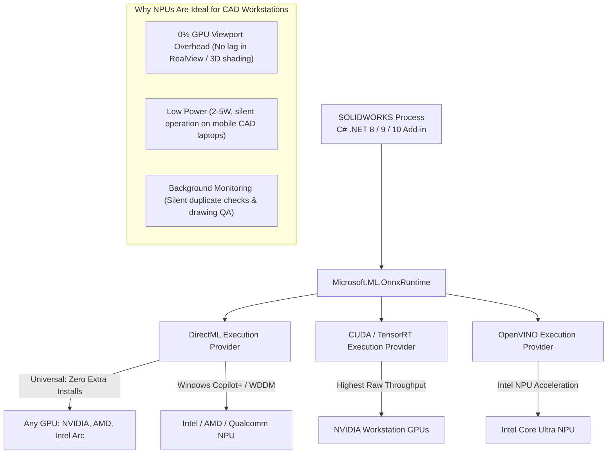
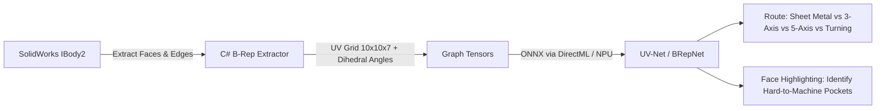
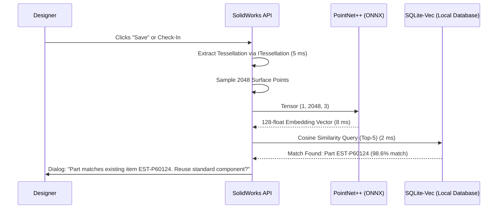
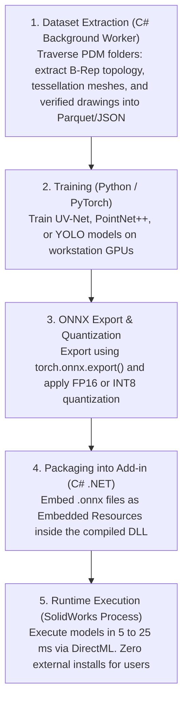

# 10.1. Local AI & Hardware Acceleration (GPU & NPU) in SolidWorks Automation

Modern CAD automation is expanding beyond traditional rule-based scripting. By integrating lightweight, specialized machine learning models (1M to 50M parameters) directly into C# .NET Add-ins, developers can solve complex engineering tasks that classic algorithms struggle with.

This guide details how to run neural networks locally inside the SolidWorks process using **ONNX Runtime**, leveraging **GPUs** and dedicated **NPUs (Neural Processing Units)** via **DirectML**, **CUDA**, and **OpenVINO**.

---

## 🚀 The Core Philosophy: "Small & Local In-Process AI"

When automating CAD software, running heavy cloud-based AI models (such as commercial Cloud LLMs) is impractical:
1. **Network Latency:** Uploading 50–100 MB 3D CAD files over the internet takes seconds. In contrast, SolidWorks UI actions must execute within **5 to 50 milliseconds**.
2. **IP & Data Privacy:** Enterprise engineering designs, pressure vessels, and proprietary parts cannot be transferred to third-party cloud servers.
3. **Domain Fitness:** General language models do not understand B-Rep (Boundary Representation) topology, 3D point clouds, or CAD drawing constraints.

**The Solution:** Compile compact, task-specific models into the open **ONNX** format and execute them locally in-memory using **`Microsoft.ML.OnnxRuntime`**.



---

## ⚡ Hardware Acceleration: CPU vs GPU vs NPU

Modern engineering workstations feature dedicated graphics cards (NVIDIA RTX / AMD Radeon Pro) and modern processors with built-in **NPUs** (Intel AI Boost, AMD Ryzen AI, Qualcomm Hexagon).

### Execution Providers (EP) in C# .NET

| Execution Provider | Supported Hardware | Enterprise Advantages | Trade-offs |
| :--- | :--- | :--- | :--- |
| **DirectML** (`Microsoft.ML.OnnxRuntime.DirectML`) | All DirectX 12 GPUs (NVIDIA, AMD, Intel) + Windows DirectML NPUs | **Recommended for production.** Ships with Windows 10/11. Requires no CUDA installation or matching drivers. Works out of the box. | ~10-15% slower than pure native TensorRT. |
| **CUDA / TensorRT** (`Microsoft.ML.OnnxRuntime.Gpu`) | NVIDIA GPUs only | Maximum raw throughput in FP16 / INT8 precision (1–5 ms latency). | Requires bulky CUDA/cuDNN DLLs (~1.5 GB) and driver version synchronization. |
| **OpenVINO** (`Microsoft.ML.OnnxRuntime.OpenVINO`) | Intel CPUs, Intel Arc GPUs, Intel Core Ultra NPUs | Highly optimized for Intel hardware; automatically targets Intel NPUs. | Targets Intel silicon only. |
| **QNN** (`Microsoft.ML.OnnxRuntime.QNN`) | Qualcomm Snapdragon X Series | High efficiency on ARM64 Windows PCs (45 TOPS NPU). | ARM64 hardware only. |
| **CPU Fallback** (`Microsoft.ML.OnnxRuntime`) | Any x64 / ARM64 processor | Universally available, zero hardware prerequisites. | Can burden CPU cores during large batch operations. |

> [!TIP]
> **Best Practice for C# Add-ins:** Use **DirectML** as your primary hardware provider. Windows 11 automatically routes supported workloads to the NPU if available, freeing the discrete GPU entirely for 3D model viewport rendering.

---

## 🛠 5 Practical Automation Use Cases

### 1. B-Rep Graph Neural Networks (GNN) for Manufacturing Routing & DFM

#### The Problem
Recognizing manufacturing features (such as pockets, holes, turned profiles, and sheet metal bends) using classic API code requires thousands of lines of fragile `if/else` checks. When working with neutral files (`STEP`, `IGES`) that lack a FeatureManager history tree, rule-based algorithms frequently fail.

#### The Architecture: UV-Net / BRepNet
In SolidWorks, every solid body is a Boundary Representation (B-Rep) topological graph $\mathcal{G} = (\mathcal{V}, \mathcal{E})$:
* **Nodes ($\mathcal{V}$):** Faces (`IFace2`). For each face, sample a $10 \times 10$ grid of UV surface points. At each point, record 3D coordinates $(x, y, z)$, normal vector $(n_x, n_y, n_z)$, and trimming flags. This forms a `(10, 10, 7)` face tensor.
* **Edges ($\mathcal{E}$):** Edges (`IEdge`). Edge attributes include curve type (line, circle, spline), dihedral angle, and length.
* **Network:** Graph Attention Networks (GATv2) process the topology to perform graph-level classification (manufacturing route) and node-level segmentation (identifying costly features).



#### SolidWorks API Implementation
1. Extract faces: `(object[])partDoc.GetBodies2((int)swBodyType_e.swSolidBody, true)` $\to$ `body.GetFirstFace()`.
2. Extract UV parameters: `face.GetUVBounds()`, then evaluate coordinates and normals with `surface.Evaluate(u, v, 1, 1)`.
3. Pass tensors to ONNX: Model size is **15–35 MB**, running in **10–20 ms** on GPU/NPU.
4. Visualize results: Highlight expensive faces in the 3D viewport using `IFace2.SetMaterialPropertyValues2()`.

---

### 2. GNN & Gradient Boosting for Automated Weld Edge Preparation (ISO 9692-1)

#### The Problem
In pressure vessels and structural frames, selecting correct weld bevel geometry (V, double-V/X, U, or bevel preparations) is governed by international standards (e.g. **EN ISO 9692-1** or AWS D1.1). Choosing edge preparations depends on sheet thicknesses $s_1$ and $s_2$, joint angle, welding process, and reverse-side access. Doing this manually is time-consuming.

#### The Architecture
The problem is solved using **Edge Classification & Regression**:
1. **Inputs:** Geometric features of the body contact interface (thicknesses, clearance, orientation).
2. **Model:** A compact **Gradient Boosted Decision Tree (LightGBM)** or **Edge-GAT**, exported to ONNX (file size: **< 2 MB**, inference time: **< 1 ms**).
3. **Outputs:**
   * Joint classification: Square, V-groove, Bevel-groove, or X-groove.
   * Parameter values: Bevel angle $\alpha$ (e.g. $50^\circ$), root face $c$ (e.g. $1.5\text{ mm}$), root gap $b$ (e.g. $2.0\text{ mm}$).
4. **Action:** The C# Add-in calls `IFeatureManager.InsertFeatureChamfer()` on target edges and updates body positions by the root gap distance.

---

### 3. 3D Geometric Duplicate Search (PointNet++ / DGCNN)

#### The Problem
Standard PDM searches rely on file names or descriptions. When different engineers name identical components differently (e.g., `Cover_Plate_10mm` vs `EST-P61355` vs imported `Part_99`), duplicate parts accumulate rapidly in the database.

#### The Architecture: 3D Siamese Networks
A 3D deep neural network converts any 3D model into a compact **128-dimensional floating-point fingerprint** (embedding), invariant to translation and rotation.



#### SolidWorks API Implementation
1. Extract triangle meshes fast from memory:
   ```csharp
   ITessellation tess = (ITessellation)model.Extension.CreateTessellation(null);
   tess.NeedFaceFacetMap = false;
   tess.TessellationQuality = (int)swTessellationQuality_e.swTessellationQuality_Coarse;
   tess.Build();
   ```
2. Sample 2048 surface points using area-weighted random sampling.
3. Compute the 128-d embedding via PointNet++ ONNX.
4. Query a local vector database (**`sqlite-vec`**): searches 100,000 components in **under 3 ms**.

---

### 4. Smart Drawing Orientation & Automated Section View Placement

#### The Problem
When generating drawings (`.SLDDRW`), the default front view orientation (`*Front`) saved in the model file is often non-informative (for example, showing only the thin edge of a plate). Determining the primary informational projection and where to place section cuts requires human judgment.

#### The Architecture: PointTransformer / 3D Voxel CNN
1. **Inputs:** Normalized 3D point cloud with surface normals, or a $64 \times 64 \times 64$ voxel grid.
2. **Outputs:**
   * Primary View Orientation: Target rotation quaternion $(q_x, q_y, q_z, q_w)$ yielding maximum projective feature variance.
   * Section Cut Plane: Coordinate and normal vector pointing to internal hollow regions and holes.
3. **Training Data:** Supervised training on historical company drawings, extracting view orientation matrices from `IView.ModelToViewTransform`.

---

### 5. Computer Vision (YOLOv11-nano) for Automated Drawing Quality Assurance

#### The Problem
Checking drawing sheets for overlapping dimension text, collision between witness lines and model geometry, or balloons overlapping the title block using mathematical API queries (`IAnnotation.GetPosition`) requires complex geometric code.

#### The Architecture: Visual Inspection via YOLOv11-nano
Treat the drawing sheet as an image. Use **YOLOv11-nano** (~2.6M parameters, **~6 MB ONNX**):

```mermaid
flowchart LR
    Drawing[IDrawingDoc Sheet] -->|High-Res Bitmap Render| BMP[In-Memory Bitmap Buffer]
    BMP -->|DirectML / NPU Inference (12 ms)| YOLO[YOLOv11-nano ONNX]
    YOLO --> D1[Class 0: Text-Geometry Overlap]
    YOLO --> D2[Class 1: Balloon Collisions]
    YOLO --> D3[Class 2: Title Block Border Violations]
    YOLO --> D4[Class 3: Dangling / Detached Dimensions]
    YOLO --> Map[Map Pixel Coords -> Sheet Meters]
    Map --> Highlight[Highlight Defects in Drawing Viewport]
```

* **Defect Classes:**
  * `0: text_edge_collision`: Dimension text overlaps model edges or hatching.
  * `1: balloon_overlap`: Balloon annotations overlap one another.
  * `2: titleblock_violation`: Drawing views or annotations enter the title block boundary.
  * `3: dangling_dimension`: Orphaned dimensions that lost their model references.
* **Coordinate Mapping:** Pixel coordinates $(p_x, p_y)$ are converted back to sheet coordinates (meters) using the sheet scale and resolution, allowing the Add-in to highlight issues directly in the GUI.

---

## 📊 Performance & Latency Benchmark Matrix

| Automation Task | Model Architecture | Input Data Shape | ONNX Size | CPU Latency (x64) | DirectML GPU | NPU (Intel/AMD) |
| :--- | :--- | :--- | :--- | :--- | :--- | :--- |
| **Manufacturing Routing** | UV-Net / BRepNet | Face/Edge Topology Graph | 15–35 MB | 45–75 ms | 8–14 ms | **10–18 ms** |
| **Weld Preparation (ISO 9692)** | LightGBM / GAT | Joint parameters vector | 1–4 MB | 2–4 ms | < 1 ms | **< 1 ms** |
| **3D Geometric Search** | PointNet++ / DGCNN | 2048 Surface Points | 10–18 MB | 30–50 ms | 6–10 ms | **7–12 ms** |
| **Drawing View Orientation** | PointTransformer | 3D Point Cloud + Normals | 20–45 MB | 60–100 ms | 12–20 ms | **15–25 ms** |
| **Drawing QA Norm-Control** | YOLOv11-nano | $1024 \times 1024$ Sheet Raster | ~6 MB | 45–80 ms | 10–15 ms | **8–14 ms** |
| **Technical Notes (SLM Bonus)**| Qwen2.5-0.5B-Instruct | Part Metadata Tokens | ~350 MB (INT4) | 250 ms/tok | 30 ms/tok | **25 ms/tok** |

---

## 💻 C# Implementation Template (.NET 8 / 9 / 10 Ready)

### 1. Project Dependencies (`.csproj`)

```xml
<Project Sdk="Microsoft.NET.Sdk">

  <PropertyGroup>
    <TargetFramework>net9.0-windows</TargetFramework>
    <PlatformTarget>x64</PlatformTarget>
    <Nullable>enable</Nullable>
  </PropertyGroup>

  <ItemGroup>
    <!-- Modern ONNX Runtime with DirectML GPU/NPU acceleration -->
    <PackageReference Include="Microsoft.ML.OnnxRuntime.DirectML" Version="1.20.1" />
    <!-- SQLite Vector Search extension for fast embedding retrieval -->
    <PackageReference Include="Microsoft.Data.Sqlite" Version="9.0.0" />
    <!-- SolidWorks Interop -->
    <PackageReference Include="SolidWorks.Interop.sldworks" Version="32.1.0" />
    <PackageReference Include="SolidWorks.Interop.swconst" Version="32.1.0" />
  </ItemGroup>

</Project>
```

### 2. Hardware-Aware Inference Session Manager

```csharp
using System;
using System.IO;
using Microsoft.ML.OnnxRuntime;

namespace SolidWorksAiAutomation.Inference
{
    public sealed class OnnxInferenceManager : IDisposable
    {
        private readonly InferenceSession _session;

        public OnnxInferenceManager(byte[] modelBytes, int deviceId = 0)
        {
            var sessionOptions = new SessionOptions();
            sessionOptions.GraphOptimizationLevel = GraphOptimizationLevel.ORT_ENABLE_ALL;

            bool hardwareAccelerated = false;

            // 1. Attempt hardware acceleration via DirectML (targets GPU and Windows 11 NPU)
            try
            {
                sessionOptions.AppendExecutionProvider_DML(deviceId);
                hardwareAccelerated = true;
                Console.WriteLine($"[AI Runtime] DirectML hardware acceleration enabled on Device #{deviceId}.");
            }
            catch (Exception ex)
            {
                Console.WriteLine($"[AI Runtime] DirectML failed to initialize: {ex.Message}. Falling back to CPU.");
            }

            // 2. Fallback to CPU execution if DirectML is unavailable
            if (!hardwareAccelerated)
            {
                sessionOptions.AppendExecutionProvider_CPU();
                sessionOptions.IntraOpNumThreads = Environment.ProcessorCount;
            }

            _session = new InferenceSession(modelBytes, sessionOptions);
        }

        public InferenceSession Session => _session;

        public void Dispose()
        {
            _session?.Dispose();
        }
    }
}
```

### 3. Computing 3D Geometry Embeddings for Duplicate Search

```csharp
using System;
using System.Collections.Generic;
using Microsoft.ML.OnnxRuntime;
using Microsoft.ML.OnnxRuntime.Tensors;

namespace SolidWorksAiAutomation.Geometry
{
    public class PartFingerprintService
    {
        private readonly InferenceSession _session;

        public PartFingerprintService(InferenceSession session)
        {
            _session = session;
        }

        /// <summary>
        /// Evaluates a 128-dimensional invariant geometric fingerprint
        /// from an input point cloud (2048 points x 3 coordinates).
        /// </summary>
        public float[] ComputeFingerprint(float[] pointCloudFlat)
        {
            if (pointCloudFlat.Length != 2048 * 3)
                throw new ArgumentException("Expected 2048 3D points (6144 floats).", nameof(pointCloudFlat));

            // Create input tensor: shape [1, 2048, 3]
            var inputTensor = new DenseTensor<float>(pointCloudFlat.AsMemory(), new[] { 1, 2048, 3 });

            var inputs = new List<NamedOnnxValue>
            {
                NamedOnnxValue.CreateFromTensor("point_cloud_input", inputTensor)
            };

            using IDisposableReadOnlyCollection<DisposableNamedOnnxValue> results = _session.Run(inputs);
            foreach (var output in results)
            {
                if (output.Name == "embedding_output")
                {
                    return output.AsTensor<float>().ToArray();
                }
            }

            throw new InvalidOperationException("Failed to retrieve embedding output from ONNX model.");
        }
    }
}
```

---

## 🗺 Production Delivery Pipeline



### Core Benefits for Engineering Teams:
1. **Zero Python Dependencies:** Models compile into standard `.dll` resources. Users require no Python runtime, virtual environments, or CUDA installations.
2. **100% Offline & Secure:** All CAD models and drawings stay inside the company's local network.
3. **Sub-25ms Response Times:** The model executes fast enough to run during interactive user clicks, auto-save events, or background batch processing.
