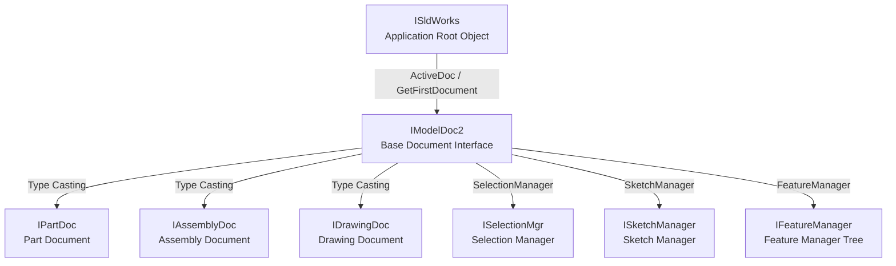

# 1.2. Basic Concepts and Types in SolidWorks API

Understanding the SolidWorks object model and hierarchy is essential. The API is built on COM architecture, where every CAD entity (part, edge, view, dimension) is represented by a specific interface.

---

## 📐 Core Interface Hierarchy

All API automation starts with the root `ISldWorks` application object. From there, you access the active document, and then navigate to specific drawing views, assembly components, or part features.



---

## 🗂 Document Type Codes

Every open document in SolidWorks is represented by the `IModelDoc2` interface. You can determine the file type by calling `GetType()`, which returns an integer value corresponding to the `swDocumentTypes_e` enumeration:

| Constant | Integer Value | Description | File Extension |
| :--- | :--- | :--- | :--- |
| `swDocPART` | **1** | Part Document | `.SLDPRT` |
| `swDocASSEMBLY` | **2** | Assembly Document | `.SLDASM` |
| `swDocDRAWING` | **3** | Drawing Document | `.SLDDRW` |
| `swDocNONE` | 0 | No document open / unrecognized | - |

---

## 🔄 Type Casting in C#

Since all document types (parts, assemblies, and drawings) derive from the base `IModelDoc2` interface, you must perform explicit type casting in C# to access specific operations belonging to a subclass.

> [!NOTE]
> In C# SolidWorks automation, always use interfaces with the prefix `I` (e.g., `IModelDoc2`, `IPartDoc`, `IAssemblyDoc`), rather than the CoClass wrapper classes without `I` (such as `ModelDoc2`, `PartDoc`). CoClass wrappers do not consistently expose compiling methods and properties in .NET interop DLLs.

### Safe C# Type Casting Example:

```csharp
using System;
using SolidWorks.Interop.sldworks;
using SolidWorks.Interop.swconst;

namespace SolidWorksAutomation
{
    public class DocumentHelper
    {
        public void ProcessActiveDocument(ISldWorks swApp)
        {
            // Retrieve active document as base IModelDoc2
            IModelDoc2 model = swApp.ActiveDoc as IModelDoc2;

            if (model == null)
            {
                Console.WriteLine("No documents are currently open.");
                return;
            }

            // Inspect document type
            int docType = model.GetType();
            
            switch ((swDocumentTypes_e)docType)
            {
                case swDocumentTypes_e.swDocPART:
                    // Cast to Part document interface
                    IPartDoc part = (IPartDoc)model;
                    ProcessPart(part);
                    break;

                case swDocumentTypes_e.swDocASSEMBLY:
                    // Cast to Assembly document interface
                    IAssemblyDoc assembly = (IAssemblyDoc)model;
                    ProcessAssembly(assembly);
                    break;

                case swDocumentTypes_e.swDocDRAWING:
                    // Cast to Drawing document interface
                    IDrawingDoc drawing = (IDrawingDoc)model;
                    ProcessDrawing(drawing);
                    break;

                default:
                    Console.WriteLine("Unknown document type.");
                    break;
            }
        }

        private void ProcessPart(IPartDoc part)
        {
            // Part-specific operations (e.g. solid bodies extraction)
            Console.WriteLine("Processing Part Document...");
        }

        private void ProcessAssembly(IAssemblyDoc assembly)
        {
            // Assembly-specific operations (e.g. adding mates)
            Console.WriteLine("Processing Assembly Document...");
        }

        private void ProcessDrawing(IDrawingDoc drawing)
        {
            // Drawing-specific operations (e.g. sheets and views)
            Console.WriteLine("Processing Drawing Document...");
        }
    }
}
```

---

## 🔗 Main Functional Managers (Accessors)

To go from a document to specialized actions, use these core manager classes:

1.  **`ISketchManager` (Accessed via `IModelDoc2.SketchManager`):** Handles entering/exiting sketch mode, drawing geometric entities (lines, arcs, rectangles), and adding dimensions.
2.  **`IFeatureManager` (Accessed via `IModelDoc2.FeatureManager`):** Controls the FeatureManager design tree (e.g. creating extrusions, cuts, sweeps, revolves, fillets).
3.  **`ISelectionMgr` (Accessed via `IModelDoc2.SelectionManager`):** Retrieves objects selected by the user (faces, edges, sketches, assembly components).

---

## ⚠️ Casting Troubleshooting

If type casting (`IPartDoc part = (IPartDoc)model;`) returns `null` or throws an `InvalidCastException` for a valid file:
1.  **Cause:** The referenced interop assembly `SolidWorks.Interop.sldworks.dll` has **Embed Interop Types** set to `True` in Visual Studio.
2.  **Solution:** Select the DLL in References, change the property to `False`, then clean and rebuild your project.
