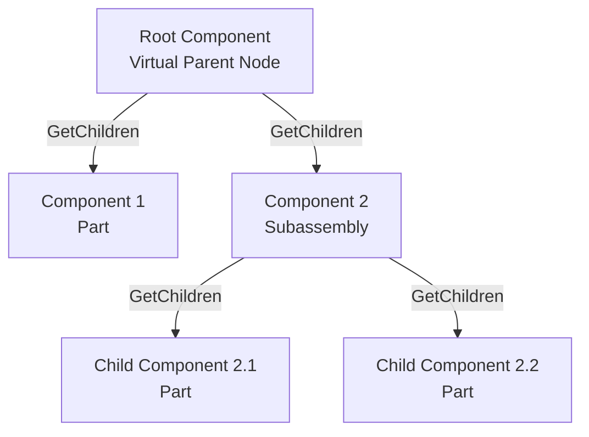

# 4.2. Components Traversal in SolidWorks using C#

To analyze the structure of an assembly (for creating BOM tables, exporting parts, or finding target components), you need to traverse the assembly tree. The SolidWorks object model represents the assembly tree as a hierarchical layout of `IComponent2` objects.

---

## 📐 Recursive Component Traversal Logic

The root of the assembly tree is a virtual component representing the active configuration. It is retrieved using `Configuration.GetRootComponent4()`. Every part and subassembly is a child component of either this root component or a parent subassembly node.



---

## 💻 C# Assembly Traversal Code Template

Here is a C# class to perform recursive traversal of assembly components, writing the hierarchical tree layout to the debug output log.

```csharp
using System;
using System.Diagnostics;
using SolidWorks.Interop.sldworks;
using SolidWorks.Interop.swconst;

public class AssemblyTraverser
{
    public void TraverseAssembly(IModelDoc2 model)
    {
        if (model.GetType() != (int)swDocumentTypes_e.swDocASSEMBLY)
        {
            Console.WriteLine("Document is not an Assembly.");
            return;
        }

        // Get the active assembly configuration
        IConfiguration config = model.GetActiveConfiguration() as IConfiguration;
        if (config == null) return;

        // Get the root component of the configuration
        // GetRootComponent4() is the recommended method for modern SolidWorks versions
        IComponent2 rootComp = config.GetRootComponent4(true) as IComponent2;
        
        if (rootComp != null)
        {
            Console.WriteLine($"Starting traversal for assembly: {model.GetTitle()}");
            
            // Start recursive traversal from level 0
            TraverseComponent(rootComp, 0);
        }
    }

    private void TraverseComponent(IComponent2 component, int level)
    {
        // Retrieve child components
        object[] children = (object[])component.GetChildren();

        if (children == null) return;

        foreach (object childObj in children)
        {
            IComponent2 child = childObj as IComponent2;
            if (child == null) continue;

            // Generate spacing to represent indentation level
            string indent = new string(' ', level * 4);

            // Read component properties
            string name = child.Name2; // Instance name (e.g., "Bolt-1")
            string path = child.GetPathName(); // File path on disk
            string config = child.ReferencedConfiguration; // Referenced configuration name
            
            // Inspect component suppression state
            int suppressState = child.GetSuppression2();
            string stateStr = GetSuppressionStateName((swComponentSuppressionState_e)suppressState);

            Console.WriteLine($"{indent}📂 Component: {name} (Config: {config}) [{stateStr}]");
            Console.WriteLine($"{indent}   Path: {path}");

            // If the component is a subassembly, traverse its children recursively
            if (child.GetChildrenCount() > 0)
            {
                TraverseComponent(child, level + 1);
            }
        }
    }

    private string GetSuppressionStateName(swComponentSuppressionState_e state)
    {
        switch (state)
        {
            case swComponentSuppressionState_e.swComponentLightweight:
                return "Lightweight";
            case swComponentSuppressionState_e.swComponentFullyResolved:
                return "Fully Resolved";
            case swComponentSuppressionState_e.swComponentSuppressed:
                return "Suppressed";
            default:
                return "Unknown";
        }
    }
}
```

---

## 🛠 Core Methods and Properties of IComponent2

| Method / Property | Type | Description |
| :--- | :--- | :--- |
| `GetChildren()` | `object[]` | Returns an array containing the child `IComponent2` objects. |
| `GetChildrenCount()` | `int` | Returns the count of first-level child components. |
| `Name2` | `string` | Returns the assembly component instance name (e.g., `"Housing-1"`). |
| `GetPathName()` | `string` | Returns the absolute file path of the component on disk. |
| `ReferencedConfiguration`| `string` | Gets or sets the name of the active configuration used for the component. |
| `GetSuppression2()` | `int` | Returns the component suppression state (`swComponentSuppressionState_e`). |
| `SetSuppression2(...)` | `int` | Suppresses (`swComponentSuppressed`) or resolves (`swComponentFullyResolved`) the component. |
| `IsPatternInstance()` | `bool` | Returns `true` if the component is an instance generated by a component pattern. |

---

## ⚠️ Important Developer Rules

1.  **Handling Suppressed Components:**
    When a component is suppressed (`swComponentSuppressed`), SolidWorks unloads its geometry from system memory. Attempting to query its child components or read feature statistics will return `null` or throw errors. Check the suppression state before calling deep geometry methods.
2.  **Handling Lightweight Components:**
    Lightweight components load only subset graphics. To read feature information (like accessing sketch entities or feature definitions), resolve the component programmatically:
    ```csharp
    child.SetSuppression2((int)swComponentSuppressionState_e.swComponentFullyResolved);
    ```
3.  **Excluding the Root Node:**
    The root node returned by `config.GetRootComponent4()` represents the assembly document itself. It has an empty file path and configuration string. Start actual component traversal from its child elements (`GetChildren()`), as shown in the example.
