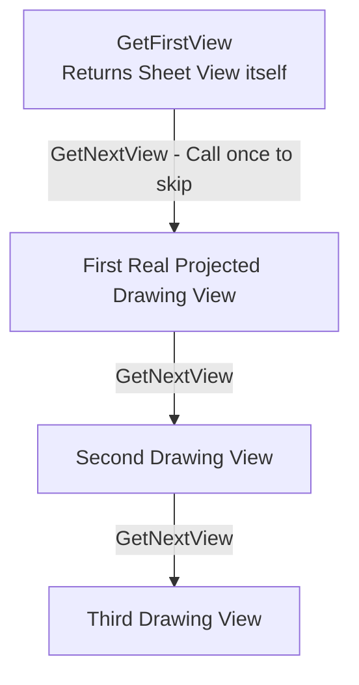

# 5.1. Drawing Basics in SolidWorks using C#

A SolidWorks drawing (`.SLDDRW`) consists of one or more sheets (`ISheet`) which contain projected drawing views (`IView`) of 3D parts or assemblies. To control drawings programmatically, cast the base `IModelDoc2` interface to `IDrawingDoc`.

---

## 📄 Managing Drawing Sheets (ISheet)

A drawing sheet defines paper formats, title block borders, and default scales.

### Core Sheet Operations:
*   `GetSheetNames()` — Returns a string array of all sheet names in the drawing.
*   `ActivateSheet(string SheetName)` — Activates the sheet by name.
*   `GetCurrentSheet()` — Returns the active `ISheet` interface.

### Reading Sheet Properties:

```csharp
using System;
using SolidWorks.Interop.sldworks;
using SolidWorks.Interop.swconst;

public class SheetManager
{
    public void ReadSheetProperties(IDrawingDoc drawing)
    {
        ISheet currentSheet = drawing.GetCurrentSheet() as ISheet;
        if (currentSheet == null) return;

        // 1. Get the sheet name
        string sheetName = currentSheet.GetName();
        
        // 2. Get scale values of the sheet
        // GetProperties2() returns an array of doubles. 
        // Elements at index 2 and 3 represent the numerator and denominator of the scale.
        double[] sheetProperties = (double[])currentSheet.GetProperties2();
        double scaleNumerator = sheetProperties[2];
        double scaleDenominator = sheetProperties[3];

        Console.WriteLine($"Sheet Name: {sheetName}");
        Console.WriteLine($"Sheet Scale: {scaleNumerator}:{scaleDenominator}");
        Console.WriteLine($"Sheet Format Name: {currentSheet.GetSheetFormatName()}");
    }

    public void RenameSheet(ISheet sheet, string newName)
    {
        // Programmatically rename a drawing sheet
        sheet.SetName(newName);
    }
}
```

---

## 🔍 Traversing Drawing Views (IView Traversal)

Every sheet has drawing views. When traversing views, understand this critical design detail:
> [!IMPORTANT]
> The method `IDrawingDoc.GetFirstView()` returns a special **sheet view** (Sheet View), which represents the sheet of paper itself (holding the title block and borders). This is **not** an actual projected drawing view.
> To iterate through the actual projected drawing views (e.g. Front, Isometric, Section), call `GetFirstView()`, and then **immediately call `GetNextView()` once**. This skips the sheet view and accesses the first true drawing view.



### Iterating Views on a Sheet in C#:

```csharp
using System;
using SolidWorks.Interop.sldworks;

public class DrawingViewScanner
{
    public void ScanViewsOnActiveSheet(IDrawingDoc drawing)
    {
        // 1. Get the initial sheet view
        IView sheetView = drawing.GetFirstView() as IView;
        if (sheetView == null) return;

        // 2. Advance to the first real drawing view
        IView currentView = sheetView.GetNextView() as IView;

        Console.WriteLine("Projected Views on Active Sheet:");

        while (currentView != null)
        {
            // Read view properties
            string viewName = currentView.GetName2(); // View name (e.g., "Section A-A")
            string modelPath = currentView.GetReferencedModelName(); // Path to the source 3D model
            string configuration = currentView.ReferencedConfiguration; // Referenced configuration name
            
            // View scale properties
            double viewScale = currentView.ScaleDecimal; // Decimal scale factor (e.g. 0.1 for 1:10)
            bool useSheetScale = currentView.UseSheetScale; // Flag: true if inheriting sheet scale

            Console.WriteLine($" - View: {viewName} (Model: {System.IO.Path.GetFileName(modelPath)})");
            Console.WriteLine($"   Config: {configuration}, Scale: {viewScale} (Inherit Sheet Scale: {useSheetScale})");

            // Advance to next view
            currentView = currentView.GetNextView() as IView;
        }
    }
}
```

---

## 🛠 Core Methods and Properties of IView

| Method / Property | Type | Description |
| :--- | :--- | :--- |
| `GetName2()` | `string` | Returns the view name (e.g., `"Section View A-A"`). |
| `GetReferencedModelName()`| `string` | Returns the absolute file path of the model referenced in the view. |
| `ReferencedConfiguration` | `string` | Gets or sets the name of the configuration referenced in the view. |
| `ScaleDecimal` | `double` | Gets or sets the decimal scale factor of the view (e.g. `0.05` for 1:20). |
| `ScaleRatio` | `double[]` | Read/write property array containing two elements `[numerator, denominator]` for scale. |
| `UseSheetScale` | `bool` | Sets whether the view scales dynamically with the sheet properties. |
| `GetFirstAnnotation2()` | `IAnnotation` | Returns the first annotation object (dimension, note, symbol) on the view. |

---

## ⚠️ Drawing View Quirks

1.  **Multiple Sheets and Active Context:**
    `GetFirstView()` and `GetNextView()` only retrieve views located on the **active sheet**. If your drawing has multiple sheets, call `ActivateSheet()` before traversing its views, and restore the original sheet context when done.
2.  **BOM Tables in View Collection:**
    BOM tables are treated as part of the view tree and can be returned during traversal. Their view type (`IView.Type`) evaluates to `swDrawingViewTypes_e.swDrawingSheet` or they are checked via annotation types.
3.  **Scale Override Property:**
    When modifying `ScaleDecimal` or `ScaleRatio` programmatically, set `UseSheetScale` to `false` to ensure the customized scale override applies to the drawing sheet display.
