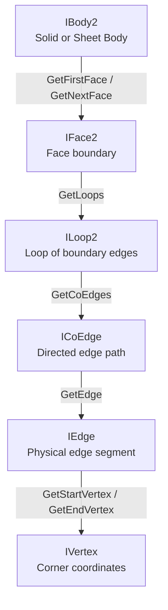

# 9.1. Bodies and Topology in SolidWorks API (C#)

SolidWorks models represent solid geometries using **Boundary Representation (B-Rep)** topology. Under this structure, a 3D model consists of a hierarchy of topological entities that define the boundary limits of a solid shape.

---

## 📐 Topological Hierarchy (B-Rep Model)

The B-Rep structure organizes topological boundaries in a parent-child relationship:



*   **`IBody2`**: Represents a physical body (can be solid, sheet metal/surface, wireframe, or temporary dummy body).
*   **`IFace2`**: A bounded section of a face. Each face is defined geometrically by an underlying `ISurface`.
*   **`ILoop2`**: A continuous, closed chain of edges enclosing a face region. Outer loops define boundaries, inner loops define holes.
*   **`ICoEdge`**: A topological helper object representing an edge relative to a specific face loop.
*   **`IEdge`**: A physical boundary line segment between two vertices. Geometrically defined by an underlying `ICurve`.
*   **`IVertex`**: A physical corner intersection representing a 3D coordinate point.

---

## 💻 C# Code: Traversing Bodies and Counting Face Types

The following C# class retrieves all solid bodies from a part, iterates through all faces of each body, and classifies them as planar or cylindrical using their underlying surface geometries.

```csharp
using System;
using System.Diagnostics;
using System.Runtime.InteropServices;
using SolidWorks.Interop.sldworks;
using SolidWorks.Interop.swconst;

public class TopologyExplorer
{
    public void TraversePartGeometry(IPartDoc part)
    {
        // 1. Retrieve all solid bodies in the part
        // swBodyType_e.swSolidBody (0) gets only solid geometry bodies
        // true returns only visible bodies
        object[] bodies = (object[])part.GetBodies2((int)swBodyType_e.swSolidBody, true);

        if (bodies == null)
        {
            Console.WriteLine("No solid bodies found in this part.");
            return;
        }

        Console.WriteLine($"Found {bodies.Length} solid bodies.");

        foreach (object bodyObj in bodies)
        {
            IBody2 body = bodyObj as IBody2;
            if (body == null) continue;

            Console.WriteLine($"Body Name: {body.Name}, Type: {(swBodyType_e)body.GetType()}");

            int planarCount = 0;
            int cylindricalCount = 0;
            int otherCount = 0;

            // 2. Retrieve the first face of the body
            IFace2 face = body.GetFirstFace() as IFace2;

            while (face != null)
            {
                // 3. Retrieve the underlying geometry surface of the face
                ISurface surface = face.GetSurface() as ISurface;
                
                if (surface != null)
                {
                    if (surface.IsPlane())
                    {
                        planarCount++;
                    }
                    else if (surface.IsCylinder())
                    {
                        cylindricalCount++;
                    }
                    else
                    {
                        otherCount++;
                    }
                }

                // 4. Traverse the next face of the body
                face = face.GetNextFace() as IFace2;
            }

            Console.WriteLine($" - Planar Faces: {planarCount}");
            Console.WriteLine($" - Cylindrical Faces: {cylindricalCount}");
            Console.WriteLine($" - Other Face Types: {otherCount}");
        }
    }
}
```

---

## 🔍 Traversing Edges of a Face

You can query all edges enclosing a face. Edges are returned as an array of `IEdge` objects via `IFace2.GetEdges()`.

```csharp
public void PrintFaceEdges(IFace2 face)
{
    object[] edges = (object[])face.GetEdges();
    if (edges == null) return;

    Console.WriteLine($"Face has {edges.Length} edges:");

    foreach (object edgeObj in edges)
    {
        IEdge edge = edgeObj as IEdge;
        if (edge == null) continue;

        // Retrieve boundary vertices
        IVertex startVertex = edge.GetStartVertex() as IVertex;
        IVertex endVertex = edge.GetEndVertex() as IVertex;

        if (startVertex != null && endVertex != null)
        {
            double[] startPt = (double[])startVertex.GetPoint();
            double[] endPt = (double[])endVertex.GetPoint();

            Console.WriteLine($" - Edge from ({startPt[0]*1000:F1}, {startPt[1]*1000:F1}, {startPt[2]*1000:F1}) mm " +
                              $"to ({endPt[0]*1000:F1}, {endPt[1]*1000:F1}, {endPt[2]*1000:F1}) mm");
        }
    }
}
```

---

## 🛠 Key B-Rep Traversal Methods

| Method | Class | Description |
| :--- | :--- | :--- |
| `GetBodies2(Type, VisibleOnly)` | `IPartDoc` | Retrieves all bodies of a given type (`swBodyType_e`). |
| `GetFirstFace()` | `IBody2` | Begins the face traversal sequence. |
| `GetNextFace()` | `IFace2` | Advances to the next face node of the body. |
| `GetEdges()` | `IFace2` | Returns an array of physical edges defining the face boundary. |
| `GetLoops()` | `IFace2` | Returns an array of boundary loops (`ILoop2`) for the face. |
| `IsOuter()` | `ILoop2` | Returns `true` if the loop represents the outer perimeter of the face. |
| `GetPoint()` | `IVertex` | Returns an array of three double coordinates `[X, Y, Z]` in meters. |

---

## ⚠️ Known Issues and Developer Rules

1.  **Memory Management During Deep Loop Iteration:**
    Traversing hundreds of faces, loops, and edges generates a massive number of unmanaged COM references. If memory leaks occur or execution slows down, call `Marshal.ReleaseComObject()` on intermediate faces, loops, and edges inside your loops.
2.  **Evaluating Suppressed Features:**
    If a feature is suppressed, its corresponding topological faces and edges are removed from the `IBody2` topology. Check that the body is fully resolved and visible before traversing geometry.
3.  **Handling Multi-Body Parts:**
    Do not assume a part contains only one body. Extrusion and sheet metal features can result in multiple separate solid bodies. Always iterate through the array returned by `GetBodies2` rather than assuming index `0` represents the entire part.
