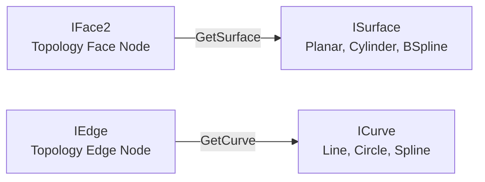

# 9.2. Surfaces and Curves in SolidWorks API (C#)

In CAD systems, it is essential to distinguish between **Topology** (e.g., `IFace2`, `IEdge` - boundary zones) and **Geometry** (e.g., `ISurface`, `ICurve` - underlying mathematical models). A face is a bounded patch of an infinite mathematical surface. An edge is a bounded segment of an infinite mathematical curve.

---

## 🗺 Geometric Representation



*   **`ISurface`**: Defines the 3D surface equation (plane, cylinder, cone, sphere, torus, or B-surface).
*   **`ICurve`**: Defines the 3D path equation (line, circle, ellipse, or spline).

---

## 💻 C# Code: Evaluating Surface Normal Vectors

For operations like CNC machining, nesting orientations, or sheet metal cutting, you often need to calculate the **normal vector** (perpendicular direction) at a specific coordinate point on a face.

Below is a C# helper method to find the normal vector of a face at its midpoint:

```csharp
using System;
using SolidWorks.Interop.sldworks;
using SolidWorks.Interop.swconst;

public class GeometryEvaluator
{
    public double[] GetFaceNormalAtMidpoint(IFace2 face)
    {
        ISurface surface = face.GetSurface() as ISurface;
        if (surface == null) return null;

        // 1. Get the parameter limits (U/V bounds) of the face
        // Returns [u_min, u_max, v_min, v_max]
        double[] uvBounds = (double[])face.GetUVBounds();
        
        // Calculate U/V coordinates of the face center point
        double uMid = (uvBounds[0] + uvBounds[1]) / 2.0;
        double vMid = (uvBounds[2] + uvBounds[3]) / 2.0;

        // 2. Evaluate the surface position and normal at U/V coordinates
        // Evaluate(U, V, NumDerivatives) returns a double array:
        // [X, Y, Z, NormalX, NormalY, NormalZ, DerU_X, DerU_Y, DerU_Z, ...]
        double[] evalData = (double[])surface.Evaluate(uMid, vMid, 1);

        if (evalData != null && evalData.Length >= 6)
        {
            double posX = evalData[0];
            double posY = evalData[1];
            double posZ = evalData[2];

            double normX = evalData[3];
            double normY = evalData[4];
            double normZ = evalData[5];

            Console.WriteLine($"Point coordinates: ({posX*1000:F1}, {posY*1000:F1}, {posZ*1000:F1}) mm");
            Console.WriteLine($"Normal vector: ({normX:F3}, {normY:F3}, {normZ:F3})");

            return new double[] { normX, normY, normZ };
        }

        return null;
    }
}
```

---

## 📏 Edge Geometry and Length Calculations

To find the physical length of an edge, you can query its topology properties or evaluate its underlying curve parameters.

```csharp
public void EvaluateEdgeGeometry(IEdge edge)
{
    // 1. Retrieve the physical length of the edge in meters
    double edgeLength = edge.GetCurveLength3();
    Console.WriteLine($"Edge Length: {edgeLength * 1000:F1} mm");

    // 2. Get the underlying curve geometry
    ICurve curve = edge.GetCurve() as ICurve;
    if (curve == null) return;

    // Check if the curve is linear or circular
    if (curve.IsLine())
    {
        Console.WriteLine("Edge is straight (Line).");
    }
    else if (curve.IsCircle())
    {
        // Get circle parameters: center, axis, radius
        // GetCircleParams() returns: [CenterX, CenterY, CenterZ, AxisX, AxisY, AxisZ, Radius]
        double[] circleParams = (double[])curve.GetCircleParams();
        double radius = circleParams[6];
        Console.WriteLine($"Edge is circular (Arc). Radius: {radius * 1000:F1} mm");
    }
}
```

---

## 🎯 Projecting Points onto Curves

If you need to check if a point lies on an edge, or find the shortest distance from a coordinate point to an edge (e.g. for collision clearance or alignment checks), project the coordinate onto the curve.

```csharp
public double[] ProjectPointOntoEdge(IEdge edge, double[] pointXYZ)
{
    ICurve curve = edge.GetCurve() as ICurve;
    if (curve == null) return null;

    // Project point onto curve
    // GetClosestPointOn(X, Y, Z, OutU) returns [ProjX, ProjY, ProjZ]
    double outU = 0;
    double[] projectedPoint = (double[])curve.GetClosestPointOn(pointXYZ[0], pointXYZ[1], pointXYZ[2], out outU);

    if (projectedPoint != null)
    {
        Console.WriteLine($"Projected Point: ({projectedPoint[0]*1000:F1}, {projectedPoint[1]*1000:F1}, {projectedPoint[2]*1000:F1}) mm");
        return projectedPoint;
    }

    return null;
}
```

---

## 🛠 Geometry Evaluation Methods

| Method | Interface | Description |
| :--- | :--- | :--- |
| `GetSurface()` | `IFace2` | Returns the underlying mathematical `ISurface` of the face. |
| `GetCurve()` | `IEdge` | Returns the underlying mathematical `ICurve` of the edge. |
| `Evaluate(U, V, Derivs)` | `ISurface` | Computes the 3D position, normal vector, and derivatives at U/V coordinates. |
| `GetCurveLength3()` | `IEdge` | Evaluates the accurate 3D length of the edge in meters. |
| `GetClosestPointOn(...)` | `ICurve` | Projects an external point coordinate onto the curve. |
| `GetArea()` | `IFace2` | Returns the surface area of the face in square meters. |

---

## ⚠️ Known Issues and Developer Rules

1.  **Face Normals Orientation:**
    The normal vector returned by `surface.Evaluate()` represents the mathematical direction of the surface. However, a face might be flipped relative to the surface normal (e.g. inside-out cylinders). Always check the boolean property `IFace2.FaceInSurfaceSense()`. If it returns `true`, the face normal matches the surface normal. If `false`, multiply your normal vector components by `-1` to get the true outward-facing normal.
2.  **Point Projections Outside Edge Boundaries:**
    `ICurve.GetClosestPointOn()` projects points onto the **infinite** mathematical curve. It does not check if the projected point lies within the physical boundaries (start/end vertices) of the `IEdge`. To verify if the point is on the physical edge, check the parameter `outU` against the parameter limits of the edge obtained via `IEdge.GetCurveParams3()`.
3.  **Coordinate Scaling:**
    All values returned by evaluation methods (points, radii, lengths) are strictly in **meters**. Multiply by `1000.0` to display values in millimeters to users.
