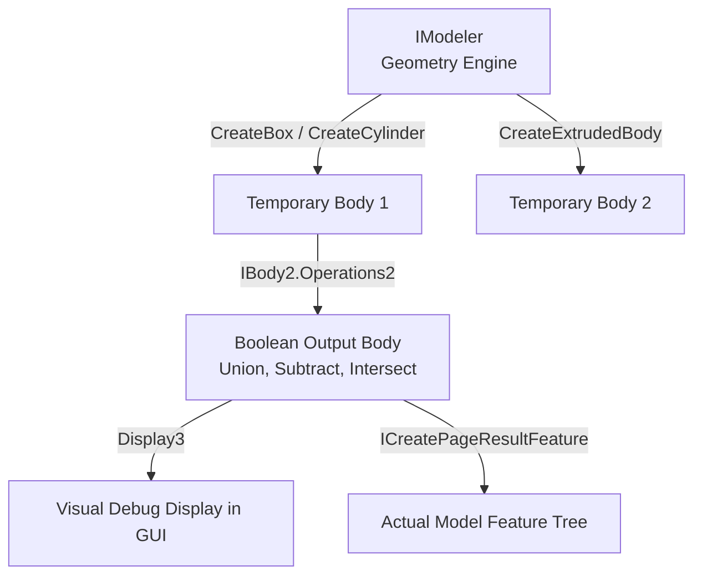

# 9.4. Modeler and Temporary Bodies in SolidWorks API (C#)

In advanced CAD/CAM applications, you often need to perform geometric operations (such as collision checking, intersection calculations, bounding box definitions, or boolean operations) without actually creating features in the model's design tree. 

The **`IModeler`** interface allows you to create **temporary bodies** in memory, manipulate them, perform calculations, and optionally display them to the user.

---

## 📐 Conceptual Workflow with Temporary Bodies



Temporary bodies exist strictly in system memory. They do not appear in the FeatureManager design tree unless you explicitly write them into a document feature using methods like `CreatePageResultFeature()`.

---

## 💻 C# Code: Creating Primitives and Performing Boolean Operations

The following C# class connects to the `IModeler` interface, creates a temporary block and a temporary cylinder, subtracts the cylinder from the block (generating a hole), and displays the resulting body inside the active document window.

```csharp
using System;
using System.Diagnostics;
using SolidWorks.Interop.sldworks;
using SolidWorks.Interop.swconst;

public class ModelerAutomation
{
    public void PerformBooleanSubtraction(ISldWorks swApp)
    {
        IModelDoc2 model = swApp.ActiveDoc as IModelDoc2;
        if (model == null) return;

        // 1. Get the Modeler interface
        IModeler modeler = swApp.GetModeler() as IModeler;
        if (modeler == null) return;

        // 2. Create a temporary block (width=100mm, height=100mm, depth=50mm)
        // CreateBox requires center position, axis directions, and dimensions (all in meters)
        double[] boxOrigin = new double[] { 0, 0, 0 };
        double[] boxAxisX = new double[] { 1, 0, 0 };
        double[] boxAxisZ = new double[] { 0, 0, 1 };
        
        IBody2 blockBody = modeler.CreateBox(boxOrigin, boxAxisX, boxAxisZ, 0.1, 0.1, 0.05) as IBody2;

        // 3. Create a temporary cylinder (radius=20mm, height=80mm) to act as a drill tool
        // CreateCylinder requires center origin, axis vector, radius, and height
        double[] cylOrigin = new double[] { 0.02, 0.02, -0.04 }; // Offset origin
        double[] cylAxis = new double[] { 0, 0, 1 }; // Extrude along Z axis
        
        IBody2 cylBody = modeler.CreateCylinder(cylOrigin, cylAxis, 0.02, 0.08) as IBody2;

        if (blockBody != null && cylBody != null)
        {
            int error = 0;

            // 4. Perform Boolean Subtraction: blockBody minus cylBody
            // Operations2 Parameters:
            // OperationType = swBodyOperationType_e.swBodyCut (2 - subtraction)
            // ToolBody = cylBody (body to subtract)
            // Error = out code
            // Returns array of resulting bodies
            object[] resultBodies = (object[])blockBody.Operations2(
                (int)swBodyOperationType_e.swBodyCut, 
                cylBody, 
                out error
            );

            if (resultBodies != null && resultBodies.Length > 0)
            {
                IBody2 resultBody = resultBodies[0] as IBody2;
                
                // 5. Display the temporary body in the active view
                // Display3 Parameters:
                // ModelDoc = active document
                // Color = color integer (RGB value)
                // Options = swTempBodyDisplayOptions_e
                int colorRed = 255;
                resultBody.Display3(
                    model, 
                    colorRed, 
                    (int)swTempBodyDisplayOptions_e.swTempBodySelectableWithOptions
                );

                Console.WriteLine("Temporary body Boolean operation completed and displayed.");
            }
            else
            {
                Console.WriteLine($"Boolean operation failed. Error code: {error}");
            }
        }
    }
}
```

---

## 🛠 Modeler and Temporary Body Methods

| Method | Interface / Class | Description |
| :--- | :--- | :--- |
| `GetModeler()` | `ISldWorks` | Returns the `IModeler` interface. |
| `CreateBox(Center, X, Z, DX, DY, DZ)`| `IModeler` | Creates a temporary solid box body. |
| `CreateCylinder(Base, Axis, R, H)` | `IModeler` | Creates a temporary solid cylinder body. |
| `Operations2(OpType, Tool, OutErr)` | `IBody2` | Performs Boolean operations (Union = 1, Cut = 2, Intersect = 3). |
| `Display3(Doc, Color, Options)` | `IBody2` | Draws the temporary body in the document viewport. |
| `Hide(Doc)` | `IBody2` | Removes the temporary body from the graphics viewport. |
| `GetMinimumDistance(...)` | `IModeler` | Finds the minimum distance and nearest points between two bodies. |

---

## ⚠️ Known Issues and Developer Rules

1.  **Garbage Collection and Temporary Bodies:**
    Temporary bodies consume memory directly outside standard assembly document allocations. Once you are done with calculations or visualization, call `Hide()` to remove them from screen displays, and call `Marshal.ReleaseComObject()` on the bodies to free system memory.
2.  **Losing Visualization on View Repaints:**
    Temporary bodies drawn using `Display3()` are **transient**. If the user clicks "Rebuild", pans, or zooms, SolidWorks clears the graphics buffer, hiding your temporary bodies. To keep the bodies visible, listen to the active view paint events and redraw them in the handler loop.
3.  **Hiding the Tool Body:**
    After calling `Operations2()`, the input tool body (`ToolBody` - e.g. the cylinder in our cut example) is consumed. Do not call methods on the tool body reference afterwards, as it will throw a COM exception.
